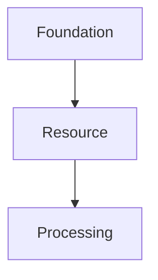

# <Product Name>

## 1. Executive Summary

<2–3 paragraphs: what the product is, for whom, core value, how it works at a high level.>

## 2. Problem and Opportunity

### The Problem
**<Pain category>**
- <Impact, quantified when possible>

### The Opportunity
- <Problem> → <how the product solves it, and the differentiator>

## 3. Target Audience

### Primary Users
**<Persona>**
- <Characteristic / need>

### Behavioral Profile
<Omit when there is a single persona.>

## 4. Objectives

**<Verb> <objective>** — Metric: <number> measured <condition>.

## 5. User Stories

### F01. <Foundation / Authentication>
- As a user, I want to <action> so that <outcome>

### F02. <Resource> Management
- As a user, I want to create a <resource> with <fields> so that <outcome>

### F03. <Background Processing>
- As the system, I want to process each new <resource> so that <derived data> is available within <SLA>

## 6. Functionalities

### F02. <Resource> Management

**Provides:**
- <Resource> id, owner, status, <key fields> (used by F03)

**Capabilities:** <limits: max N per user, field lengths, formats, rules>

**Experience:** <screen-by-screen flow, validations, messages, empty/loading/error states>

**Error Handling:** <3–5 failure scenarios with exact messages — only for critical features>

### F03. <Background Processing>

**Consumes:**
- F02: <resource> id, status, <key fields>

**Core Scope:**
- <essential capability>

**Full Scope additions:**
- <enhancement for later>

**Capabilities:** <...>

**Experience:** <...>

## 7. Out of Scope

**<Category>**
- <Excluded capability>

## 8. Dependency Graph

| # | Feature | Priority | Dependencies |
|---|---------|----------|--------------|
| F01 | <Foundation / Authentication> | 1 | None |
| F02 | <Resource> Management | 1 | F01 |
| F03 | <Background Processing> | 2 | F02 |

### Foundation Features
These features set up shared project infrastructure. In a greenfield project they must be implemented sequentially before or alongside any feature that depends on them:
- **F01 <Foundation / Authentication>** — <scaffolding, layout, DB, session middleware>

### Execution Waves
Features within the same wave can be built in parallel. A wave starts only after every feature in earlier waves is complete.

**Note:** Foundation features cannot run in parallel in a greenfield project even if they appear together in a wave — they share scaffolding files and must be implemented sequentially until the base is in place.

- **Wave 1**: F01
- **Wave 2**: F02
- **Wave 3**: F03

### Priority levels
- **1** = Essential — product does not work without it
- **2** = Important — significant value addition
- **3** = Desirable — incremental improvement

## 9. Acceptance Criteria

### F02. <Resource> Management
- [ ] User can create a <resource> with valid <fields>
- [ ] Creating a <resource> with an empty name shows "<exact message>"

### F03. <Background Processing>
- [ ] A new <resource> reaches status `<ready>` within <SLA>

### Cross-Feature Integration
- [ ] <Resource> created in F02 is picked up and processed by F03
